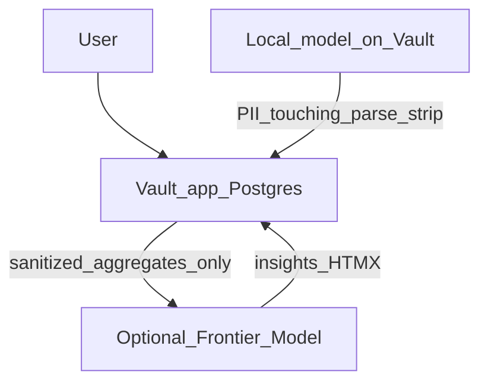

# SAPPHIRE

**SAPPHIRE** is a mathematically rigorous, fail-loud financial document extraction and reconciliation pipeline.

It enforces strict financial invariants, closed canonical schemas, and zero-PII egress to external models. Raw, ragged PDF statement data becomes balanced, integer-cents ledger records inside a single **Vault** deployable (Postgres + FastAPI + HTMX).

## Architecture



Two different “local model” questions — keep them separate:

| Lane | Local models? | Why |
|------|---------------|-----|
| **Development (Cloud-Build)** | **No** — cloud agents shape/build code. No `pi-up.sh` / local coding LLM required. | Delivery process only. |
| **Runtime (Vault / PII pipeline)** | **Yes** — models that see raw statements run **on the Vault** (or same trust boundary). | PII stripping / extraction must not send raw docs to cloud. |

- **Vault:** Owns PDFs, PII, ledgers, dashboard, MCP, and any local inference used for parse/strip.
- **Frontier (optional):** Sees anonymous aggregates only—never raw statements or amounts in logs.
- **Not required:** a separate “AI Brain” workstation as a second product box. Local models are Vault-side runtime, not a parallel deploy to operate.

## Engineering Rigor

- **Financial Precision (`BIGINT`):** All money is integer cents. No floats for currency.
- **Fail-loud contracts:** Schema drift, missing markers, and recon breaks raise explicit exceptions.
- **TDD & coverage:** `uv run pytest --cov=app --cov-fail-under=90 -v` (≥90%).
- **Mutation (nightly on main):** Financial allowlist via `.github/workflows/mutation-nightly.yml`—not a PR blocker.

Planning uses Shape Up (`ARCH_PLAN.md`, `docs/specs/`). User-visible pitches must include shaping-phase wireframes under `docs/specs/visuals/`.

## Quick Start & Verification

**1. Install Dependencies**
```bash
uv sync
```

**2. Run the Test Suite**
```bash
uv run pytest --cov=app --cov-fail-under=90 -v
```

**3. Run Linter & Formatter**
```bash
uv run ruff check .
uv run ruff format .
```

**4. Dashboard (optional)**
```bash
uv run uvicorn app.api.app:app --host 127.0.0.1 --port 8000
```
Open `http://127.0.0.1:8000/dashboard`. Baseline wireframe: `docs/specs/visuals/dashboard_baseline_wireframe.html`.

## Troubleshooting & Agent Runbooks

### CI & Mutation Testing (`mutmut`)
* **PR CI (required):** lint, format, coverage ≥90%. **Mutation is not a PR blocker.**
* **Nightly / main:** `.github/workflows/mutation-nightly.yml` runs full allowlist mutation.
* **Classic score:** `killed / (killed + survived)`. `no_tests` is a separate hard fail.
* See `AGENTS.md` for full mutation and process rules.
