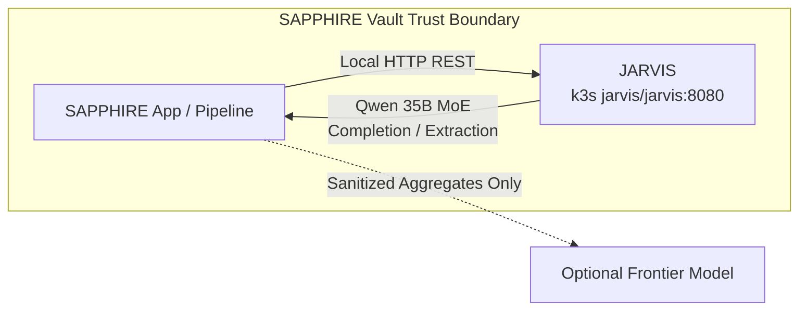

# Pitch: Watchtower inference integration

**Status:** Shipped  
**Builder:** Cloud agent (Cloud-Build Mode)  
**Bettor:** Human PM  
**Appetite:** Small Batch (2 weeks)

---

## Problem

[`docs/architecture/system_design.md`](../architecture/system_design.md) specifies a single Vault trust boundary where raw financial statements and PII are processed by local models for extraction and redaction before any external cloud interaction. While the Watchtower k3s cluster now hosts containerized llama-server inference on an NVIDIA RTX 3060 (12GB) serving Qwen 35B MoE, SAPPHIRE lacked a client interface, exception hierarchy, and verification suite to communicate with the inference engine without leaking PII or violating the fail-loud contract.

## Appetite

**Small Batch (2 weeks).** Fixed time, variable scope. Good enough: a robust, zero-PII client interface (`VaultInferenceClient`) configured via environment variables, integrating live model discovery, chat completion, PII stripping, and structured extraction with comprehensive fail-loud negative test cases.

## Solution (breadboard)

1. Core client module in `app/core/inference.py` wrapping the OpenAI-compatible JARVIS endpoint (`http://ai.watchtower.local/v1`, or `http://127.0.0.1:8080/v1` on the node).
2. Explicit exception taxonomy (`InferenceError`, `InferenceConnectionError`, `InferenceContractError`) descending from `PipelineError`.
3. High-level capabilities: `get_models()`, `complete()`, `strip_pii()`, and `extract_structured()`.
4. Strict zero-PII logging invariant: operational telemetry (model, duration, token counts) is logged while raw prompts, PII, and financial amounts are excluded.
5. Executable acceptance script `scripts/qa_watchtower_inference.py` asserting happy path and negative error cases.

## Visuals (shaping — required if user-visible)

Manual UI QA: not applicable (no user-visible UI).

## Rabbit holes

- Fine-tuning or retraining weights inside the client code.
- Running local model weights on operator workstations (violating zero-local-compute constraint).
- Over-abstracting across 10 different LLM SDK providers instead of a direct HTTP client.

## No-gos

- Egressing raw statement text, unmasked accounts, or row-level PII to external cloud models.
- Running LLM execution on Haswell developer workstation.
- Logging prompt text or raw extracted balances.

## Done-when

- [x] Executable QA: `uv run python scripts/qa_watchtower_inference.py` prints `[PASS]` / `[FAIL]` for happy and negative cases
- [x] Manual UI QA: not applicable (no user-visible UI)
- [x] Core invariants held: integer cents, fail-loud contracts, no PII/amount logging
- [x] CI gates: `uv run ruff check .`, `uv run ruff format --check .`, `uv run pytest --cov=app --cov-fail-under=90 -v`
- [x] Exception taxonomy integrated into contract tests

## Circuit breaker

At appetite end: ship the core client, contract exceptions, and QA script, or circuit-break.
