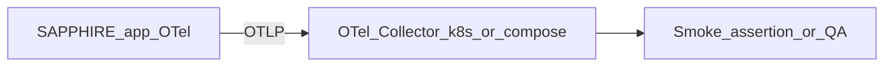

# Pitch: Watchtower telemetry path

**Status:** Shaped  
**Builder:** Cloud agent (Cloud-Build Mode)  
**Bettor:** Human PM  
**Appetite:** Small Batch (2 weeks)

---

## Problem

[`docs/architecture/observability.md`](../architecture/observability.md) describes a full Watchtower edge stack (OTel Collector → Tempo / Prometheus / Loki → Grafana). The repo has app-side telemetry helpers and a partial [`k8s/observability/`](../../k8s/observability/) collector config, but there is no **verifiable smoke path** that proves spans leave the app and reach a local collector without inventing a SaaS APM. Operators cannot tell “instrumented” from “actually exported.”

## Appetite

**Small Batch (2 weeks).** Fixed time, variable scope. Good enough: one documented, scriptable path that emits a pipeline span, exports via OTLP to a collector defined in-repo, and fails loudly if export/config is broken. Full Grafana UX and multi-node sampling are out of appetite if time runs short.

## Solution (breadboard)

1. Wire/confirm app export config against the in-repo collector config under `k8s/observability/`.
2. Emit at least one taxonomy span from the ingest/pipeline boundary (e.g. `ingress.receive` or `reconciliation.verify`).
3. Add `scripts/qa_watchtower_telemetry.py` that starts or assumes the local collector path, triggers a synthetic run, and asserts the export path (happy) and a broken-endpoint/config case (negative, fail loud).
4. Document the one command the PM runs; no SaaS keys.

## Rabbit holes

- Building a complete Grafana/Tempo/Prometheus/Loki production HA stack
- Perfect span coverage for every adapter line
- Cardinality tuning for every RED metric in the architecture doc
- Homelab Traefik / TLS rabbit holes unrelated to OTLP smoke

## No-gos

- External SaaS APM (Datadog, Honeycomb, New Relic, etc.)
- Logging raw PII, account numbers, or monetary amounts (`amount_cents`, `amount`)
- Inventing frontend SRI hashes or asset UUIDs
- Expanding Phase 2 product UI as part of this bet

## Done-when

- [ ] `uv run python scripts/qa_watchtower_telemetry.py` shows happy path `[PASS]` and intentional negative `[PASS]` (loud failure expected)
- [ ] Manual UI QA: not applicable (no user-visible UI) **unless** a Grafana screen is explicitly in shipped scope—then document start + click path
- [ ] No PII/amount logging introduced; integer-cents invariants untouched
- [ ] CI gates green; `ARCH_PLAN.md` moves this pitch to shipped archive or notes circuit-break

## Circuit breaker

At 2 weeks: ship collector smoke + QA, or drop. Unfinished Grafana/dashboard polish returns to [`raw_backlog.md`](raw_backlog.md).
