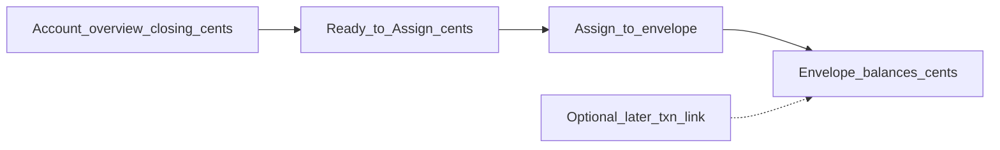

# Pitch: YNAB budgets / envelopes

**Status:** In-bet  
**Builder:** Cloud agent (Cloud-Build Mode)  
**Bettor:** Human PM  
**Appetite:** Small Batch (2 weeks)  
**Product north star:** YNAB-useful personal Vault — give assigned dollars a job  
**Depends on:** Account overview home — shipped ([#50](https://github.com/bstruong/assassin/pull/50))  
**Board:** Private GitHub Project **SAPPHIRE Shape Up** (Lane=In-bet)

---

## Problem

Account overview answers “what do I have?” It does not answer “what is this money for?”

- The PM wants the useful core of **You Need A Budget**: dollars assigned to **envelopes / budget categories**, not only account balances.
- Uploaded statements create transactions, but there is **no first-class budget layer** in the Vault (no envelope balances, no assignment of ready-to-assign money).
- Without envelopes, the overview stays a statement viewer — not a planning surface.

## Appetite

**Small Batch (2 weeks).** Fixed time, variable scope.

**Good enough when time runs out:** On the dashboard, a **Budget** view (or Pane 2 mode) shows a small set of **envelopes** with integer-cent balances; the PM can **assign** available cents into envelopes and see **Ready to Assign** update. Happy path uses synthetic seed data. Loud failure on over-assign (assign more than available) and on non-integer / float payloads. No goals, no multi-month forecasting, no bank sync beyond existing ingest.

**Thin prerequisite allowed inside this appetite:** a minimal category/envelope name list (create + list) if needed to assign — not a full taxonomy editor.

## Solution (breadboard)

1. **Envelope model** — Named envelopes with `balance_cents` (BIGINT / `int`). Fail-loud validation; no floats.
2. **Ready to Assign** — Derived from Vault account closings (or an explicit “to assign” pool seeded for QA) minus sum of envelope balances. Display as USD via existing `usd_cents` filter.
3. **Assign action** — HTMX form: pick envelope, amount (USD input converted strictly to integer cents, or cents field). Over-assign → loud error.
4. **Budget pane** — Templated list of envelopes + Ready to Assign; sits alongside overview (tab/toggle or secondary section — wireframe decides).
5. **Seed + QA** — Synthetic envelopes only (`SYNTHETIC Groceries`, etc.).

**Out of first slice but called out:** linking each transaction to an envelope (can return as follow-up pitch if time runs out).

## Visuals (shaping)

- Baseline overview: [`visuals/account_overview_wireframe.html`](visuals/account_overview_wireframe.html)
- Proposed budget/envelopes: [`visuals/ynab_budgets_wireframe.html`](visuals/ynab_budgets_wireframe.html)

## Rabbit holes

- Full YNAB parity (goals, age of money, reports, multi-month, reconciliation wizard)
- Automatic categorization ML / rules engine
- Shared household budgets / multi-user permissions
- Redesigning all dashboard chrome
- Floating-point money math or “dollar string” coercion without fail-loud cents conversion

## No-gos

- Goals, scheduled transactions, credit-card payment matching workflows
- Cloud sync of raw statements; frontier seeing envelope row PII beyond aggregates already allowed
- Float monetary types in DB or Python
- Generative HTML for budget UI
- Watchtower / Grafana
- New bank adapters

## Done-when

- [ ] `uv run python scripts/qa_ynab_budgets.py` — happy assign; negative over-assign / invalid amount fail loud; amounts integer cents in storage
- [ ] Manual UI QA documented below (matches wireframe)
- [ ] Wireframe linked
- [ ] Project board item Lane updated to In-bet on bet / Shipped on merge
- [ ] Core invariants: integer cents, fail-loud, no PII/amount logging
- [ ] CI gates green

## Manual UI QA (for build cycle)

1. Seed or upload so overview has account closings (or use seed script from the bet).
2. `uv run uvicorn app.api.app:app --host 127.0.0.1 --port 8000`
3. Open `http://127.0.0.1:8000/dashboard` → open **Budget** surface
4. Happy: see **Ready to Assign** as USD; assign to `SYNTHETIC Groceries`; envelope balance and Ready to Assign update
5. Negative: assign more than available → loud rejection with `ASSIGN_EXCEEDS_AVAILABLE` (no silent clamp)
6. Confirm DB / API still use integer cents (UI shows USD)

## Circuit breaker

At 2 weeks: ship Ready to Assign + envelope list + assign, even if transaction→envelope linking is unfinished (return that to Project Lane=Raw). If category naming is the only blocker, ship a fixed starter envelope set.
